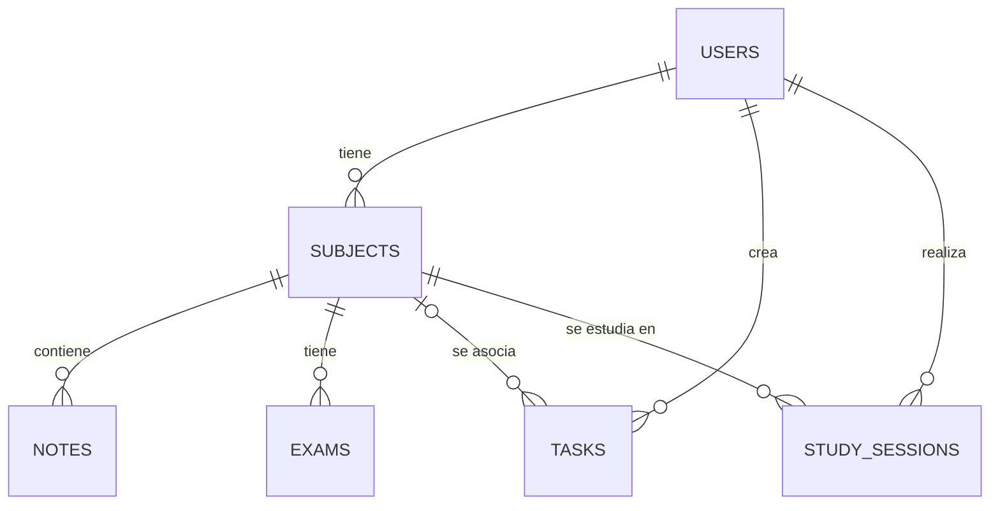

# Studify API

Backend de **Studify**, una aplicación web para estudiantes que organiza tareas, materias, apuntes, exámenes y sesiones de estudio. Está desarrollado con **NestJS** y se encarga de gestionar las peticiones que llegan desde el frontend (React).

- **Frontend:** `https://github.com/FrancoTms/Studify-N2`
- **Repositorio del backend:** `https://github.com/FrancoTms/Studify-Backend`

## Estado del proyecto

| Etapa | Estado |
| --- | --- |
| Creación del proyecto con Nest CLI | Hecho |
| Organización en módulos (`src/modules`) | Hecho |
| Recursos REST con CRUD generados por módulo | Hecho |
| Diseño de la base de datos relacional | Hecho (script SQL incluido) |
| Conexión del backend con la base de datos | Pendiente |
| Lógica de negocio y autenticación | Pendiente |

> En esta etapa se genera y organiza la estructura. Los endpoints existen, pero todavía no leen ni guardan datos en la base de datos.

## Tecnologías

- [NestJS](https://nestjs.com/) y [TypeScript](https://www.typescriptlang.org/)
- [Node.js](https://nodejs.org/) y npm
- Base de datos relacional (MySQL 8.0.16 o superior)
- Git y GitHub

## Requisitos previos

- Node.js (versión LTS recomendada) y npm
- Git
- Un gestor de MySQL (por ejemplo, MySQL Workbench o XAMPP) para crear la base de datos
- Opcional: Nest CLI global (`npm install -g @nestjs/cli`) para generar nuevos recursos

## Instalación y ejecución

1. Clonar el repositorio:

   ```bash
   git clone <URL-del-repositorio>
   cd <nombre-del-proyecto>
   ```

2. Instalar las dependencias:

   ```bash
   npm install
   ```

3. Iniciar el servidor en modo desarrollo:

   ```bash
   npm run start:dev
   ```

4. Verificar que funciona abriendo `http://localhost:3000`. Debe mostrarse el mensaje de bienvenida de la aplicación.

### Otros comandos

| Comando | Descripción |
| --- | --- |
| `npm run build` | Compila el proyecto en la carpeta `dist/` |
| `npm run start:prod` | Ejecuta la versión compilada |

## Estructura del proyecto

El código está organizado por módulos dentro de `src/modules`. `main.ts` permanece en `src/`.

```
src/
├── main.ts
└── modules/
    ├── app/              # Módulo raíz
    │   ├── app.controller.ts
    │   ├── app.module.ts
    │   └── app.service.ts
    ├── users/            # Cada recurso incluye dto/, entities/,
    ├── auth/             # controller, module y service
    ├── subjects/
    ├── notes/
    ├── exams/
    ├── tasks/
    └── study-sessions/
```

### Módulos

| Módulo | Responsabilidad | Sección del frontend |
| --- | --- | --- |
| `users` | Datos de los usuarios | Perfil del sidebar |
| `auth` | Inicio de sesión y registro | Pantalla de login |
| `subjects` | Materias y su progreso | Mis materias |
| `notes` | Apuntes de cada materia | Mis apuntes |
| `exams` | Fechas de exámenes | Próximos exámenes |
| `tasks` | Tareas con prioridad y estado | Plan de hoy |
| `study-sessions` | Sesiones de estudio y su duración | Pomodoro y horas estudiadas |

Cada módulo expone un CRUD REST con las rutas generadas por Nest CLI. Por ejemplo, para `users`:

| Método | Ruta | Acción |
| --- | --- | --- |
| `POST` | `/users` | Crear |
| `GET` | `/users` | Listar |
| `GET` | `/users/:id` | Obtener uno |
| `PATCH` | `/users/:id` | Actualizar |
| `DELETE` | `/users/:id` | Eliminar |

El resto de los módulos siguen el mismo patrón (`/subjects`, `/notes`, `/exams`, `/tasks`, `/study-sessions`). El módulo `auth` usa la tabla `users`.

## Base de datos

El script `database/studify.sql` crea la base `studify`, sus tablas y datos de ejemplo (5 o más registros por tabla), e incluye consultas para verificar la carga.

### Cómo crearla

- Desde MySQL Workbench: abrir el archivo y ejecutarlo completo.
- Desde la terminal:

  ```bash
  mysql -u root -p < database/studify.sql
  ```

El script se puede ejecutar más de una vez: borra y vuelve a crear las tablas.

### Tablas y relaciones

| Tabla | Descripción | Clave foránea |
| --- | --- | --- |
| `users` | Usuarios del sistema | |
| `subjects` | Materias de cada usuario | `user_id` → `users` |
| `notes` | Apuntes de cada materia | `subject_id` → `subjects` |
| `exams` | Exámenes de cada materia | `subject_id` → `subjects` |
| `tasks` | Tareas del usuario, con materia opcional | `user_id` → `users`, `subject_id` → `subjects` |
| `study_sessions` | Sesiones de estudio | `user_id` → `users`, `subject_id` → `subjects` |



### Restricciones principales

- `users.email` es único.
- `subjects.progress` debe estar entre 0 y 100, y el nombre de la materia es único por usuario.
- `study_sessions.duration_minutes` debe estar entre 1 y 600.
- Al borrar un usuario o una materia se eliminan sus datos dependientes. En `tasks`, si se borra la materia, la tarea queda sin materia.

## Flujo de trabajo

El trabajo se integra mediante ramas y Pull Requests. Los mensajes de commit siguen el formato `tipo: descripción` (por ejemplo, `feat: genera estructura de módulos del backend con Nest CLI`).

## Integrantes

- `Garcia, Franco Tomas`
- `Busnelli, Bruno`